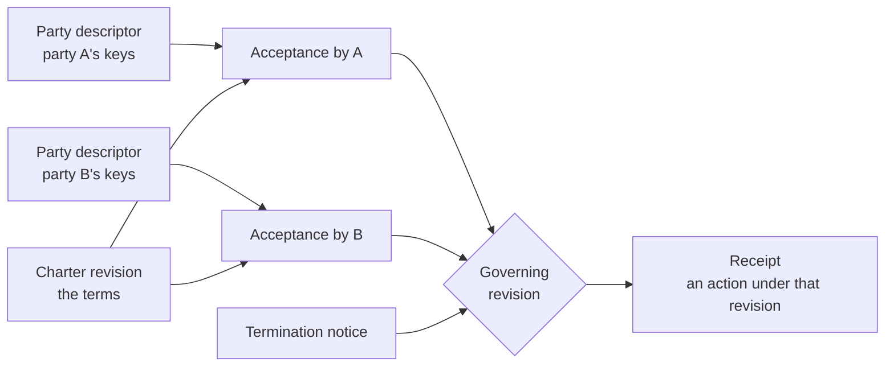

# Overview

Two companies, or two companies' software agents, agree on terms. Later they amend
them, maybe end them, and act under them in between. Each side keeps its own records,
and there is no shared database to settle what was agreed. CAP gives both sides the
same evidence: signed, byte-exact artifacts that either side, or an auditor years
later, can verify and get the same answer from.

## The questions CAP answers

- **Which revision is in force right now?** Agreements change. Both parties need the
  same answer for the same instant, computed from evidence each can check.
- **Did both parties accept this exact revision?** An acceptance signs the revision's
  exact bytes, with a key the other side can trace to the signer's published key
  history.
- **What if a party signs two different revisions at the same number?** CAP keeps both
  as evidence and, for an instant at which both compete, reports the charter as
  contested. It never picks a winner. A new revision that both parties accept, and
  that descends from or supersedes each competing one, repairs the fork. The answer
  is per instant, so a contest also ends at instants after a competing revision's
  effective window closes; the fork evidence stays in the facts either way.
- **Which revision was an action taken under?** A receipt ties a signed action to the
  exact revision and deployment it ran under, so anyone can check it later.

CAP answers these with facts derived from verified signatures and digests. It does not
answer whether the evidence is enough for your purpose. That is your application's
decision.

## How the artifacts fit together

- A **party descriptor** is one party's signed key history. Each new descriptor is
  signed by a key from the one before it, so a rotation or a retired key stays
  visible.
- A **charter revision** is the agreed terms as canonical JSON. It names both parties
  (by their descriptor digests), the digest of the legal text, whether the legal text
  or machine-readable terms govern, when it takes effect, and the reasons either party
  may terminate. Revisions are unsigned. Assent comes from acceptances.
- An **acceptance** is one party's signature over one exact revision. A revision
  counts as accepted when every party has accepted it.
- A **termination notice** is one party's signed notice that the charter ends at a
  stated instant, for a reason the revision lists.
- A **receipt** is a signed record of an action, tied to the revision that governed it.

`verify_chain/5` takes the descriptors, revisions, acceptances and termination
notices as raw bytes, verifies every one, and returns facts about the whole set.
Receipts are verified separately, with `verify_receipt/3` against those facts. `governing_revision/2` then tells you which revision was in
force at a given instant. The [artifacts reference](artifacts.md) lists every member,
and [verification semantics](verification.md) explains how forks, supersession and
termination work.

## What CAP checks and what it leaves to you

CAP checks:

- every signature, against the key the signer's descriptor history says was active;
- that each acceptance names the exact revision bytes and a party the revision lists;
- key-history continuity, and forks in a history;
- which revision governs at an instant, and when the view is contested;
- that every artifact is canonical, well formed, and within the size limits you set.

CAP does not decide, and says so in every result:

- whether a party may take an action;
- whether the terms were met;
- whether an effect actually happened;
- legal validity;
- whether you were shown every artifact that exists;
- what time it is. You pass the instant in.

Each facts record carries this list under `not_verified`, and no option can shorten it.
The [security model](security-model.md) covers what that means for an application.

## Design choices that matter to you

- **Same bytes, same answer.** Encoding is strict: unpadded base64url, canonical
  JSON, and domain-separated SHA-256 digests. Two implementations (this one, and the
  TypeScript verifier) must produce byte-identical reports on every case in the
  conformance corpus.
- **No silent tie-breaks.** A fork is reported as a fork. Nothing in CAP orders
  digests to pick a winner.
- **No side effects.** Verification reads no clock, file, network or environment. You
  supply the time, the limits and the key material.
- **Errors you can log.** Every failure is a typed error with a fixed code. Errors
  never contain the input that failed.
- **No runtime dependencies.** CAP uses OTP's `:crypto` and nothing else.

## Related protocols

- **Agent Blueprint Protocol (ABP).** A revision can name, for each party, the exact
  agent build and deployment it runs. CAP checks that those digests are byte-exact;
  ABP defines what they mean.
- **Bounded Authority Protocol (BAP).** A receipt's `grant` member can carry the digest
  of a BAP grant. CAP checks the digest bytes; BAP defines what a grant is.

CAP uses neither package at runtime. It shares fixed test vectors with both.

## What CAP is not

- Not an identity provider. A descriptor proves key continuity, not who a company is.
- Not a revocation service. It does not check live revocation or transparency logs.
- Not a policy engine. It does not evaluate terms.
- Not a record of effects. A receipt that says an effect was committed is the issuing
  party's signed claim, not proof the effect happened.
- Not legal advice. Legal validity is outside every result.
